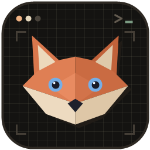

<div align="center">
  
  <h1>oxicode</h1>
  <p><strong>Fast, low-memory terminal AI coding agent in Rust.</strong></p>
  <p>
    
    
    
  </p>
  <p><a href="README.md">Русский</a> | <strong>English</strong></p>
</div>

## What is this

**oxicode** is a native terminal AI coding assistant written in Rust. It ships and runs as a single standalone executable (`oxicode.exe`) with zero external runtime files.

## Features

- **10 Built-in Providers** — AnyModel, OpenCode Zen, OpenRouter, NVIDIA NIM, Google Gemini, OpenAI, Anthropic, DeepSeek, Ollama, and Custom OpenAI-compatible endpoints.
- **UI Styles and Themes** — switch layouts via `/style` (`OxiCode` with an animated 3D fox, `Antigravity` with a static pixel fox and clean `> ` prompt, `Logo`), plus 15 color themes (`/themes`, including `beige`, `classic`, and `monochrome`).
- **Interactive Setup (`/connect`, `/settings`)** — API key and base URL forms with hierarchical `Esc` back-navigation across nested screens, live model browser (`/models`), and persistent sessions (`/sessions`, `--continue`).
- **Native Text Selection** — mouse capture is disabled by default so you can freely highlight and copy text with the mouse (`/mouse` toggles wheel scrolling and hover fox tracking).
- **Coding Tools and Safety** — `read_file`, `write_file`, `edit_file`, `list_files`, `glob`, `grep`, `bash` (UTF-8), scrollable diff approval previews, `/undo`, `/redo`, and change summaries.
- **Context and Extensions** — `/compact`, stdio MCP (`/mcp`), plugins (`/plugins`), skills (`/skills`), custom `/` commands, `@` file mentions, and `!` shell commands.

## Download

Compile the single executable `oxicode.exe` with Cargo and run `oxicode --install`, or download prebuilt binaries from [Releases](../../releases). All other directories (`src`, `assets`, `Cargo.toml`) are only needed for building from source.

## Quick Start

1. Build and install:

```bash
cargo build --release -p oxicode
oxicode --install
```

2. Run and explore:

```bash
# Interactive TUI
oxicode

# List supported providers
oxicode --providers

# List live models for OpenCode Zen
oxicode --provider opencode --models

# Run with a specific provider and model
oxicode --provider openrouter --model deepseek/deepseek-chat-v3-0324:free
```

## Requirements

- **Rust** — version 1.85+ (edition 2024) to build from source.
- **Terminal** — Windows Terminal, PowerShell, Alacritty, Kitty, or iTerm2 with UTF-8 and TrueColor support.

## Uninstall

Remove `oxicode.exe` (for example from `%USERPROFILE%\.cargo\bin\oxicode.exe`), and optionally the repository folder and user configuration directory (`%APPDATA%\oxicode` on Windows or `~/.config/oxicode` on Linux/macOS).
